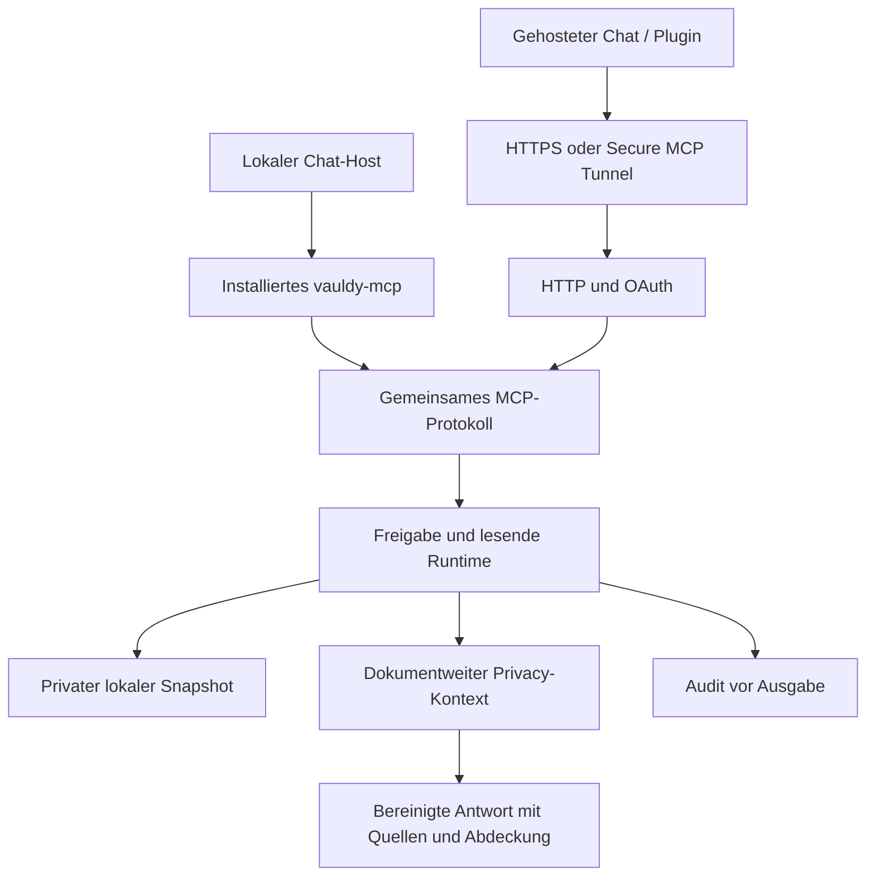

# Architekturanalyse: MCP-Erreichbarkeit und Retrieval-Skalierung

Stand: 03.11.2026. Analysierter Quellstand: `41b6fe9`, MCP 0.10.0. Analyse mit anschließend geprüfter Umsetzung 0.11.0.

## Auftrag und Prüfgrenzen

Untersucht werden die vollständige lokale Zugriffskette und der Aufwand für Bestände mit 1.000–2.000 Dokumenten. Das alte App-Repository bleibt eingefroren. Originale, OCR und bestehende Dokumentfreigaben werden nicht verändert. Produktion wird nur für die lesende Diagnose der Programmzuordnung betrachtet; alle Reproduktionen und Zeitmessungen verwenden künstliche Bestände und private temporäre Installationen.

Eine erfolgreich gestartete MCP-Verbindung ist getrennt von Tool-Discovery im Zielchat, erfolgreicher Autorisierung und tatsächlich verwendeten Chat-Werkzeugen zu bewerten. Der letzte Versicherungsabruf lief über eine manuell gestartete lokale MCP-Verbindung mit bestehender Freigabe. Er belegte keine geladene ChatGPT-Plugin-Verbindung.

## Komponenten und Verantwortlichkeiten

| Schicht | Eigentümer / maßgebliche Quellen | Verantwortung |
|---|---|---|
| Chat-Host | Clientregistrierung / jeweiliger ChatGPT- oder Claude-Host | MCP-Prozess starten bzw. Remote-Plugin laden, Werkzeugkatalog pro Sitzung |
| Einrichtung | VauldyMCPSetup, MCPInstallation, MCPClientRegistration | Native UI, dedizierte Installation, exakte Clientbindung, Dokumentfreigabe |
| Lokaler Transport | VauldyMCPServer | stdio, Initialisierungskompatibilität, Audit, Prozessstatus |
| Remote-Transport | VauldyMCPHTTP, VauldyOAuth | Loopback-HTTP hinter Betreiber-HTTPS, OAuth, verbindungsgebundene Sitzungen |
| Protokoll | VauldyMCPProtocol | Gemeinsame vier Werkzeuge, Schemas und Dispatcher |
| Freigabe und DTOs | VauldyMCPRuntime | Profil vor/nach Aufruf prüfen, nur zugelassene IDs, Privacy, Handles, Cursor, Abdeckung |
| Lokale Daten | VauldyCore | Snapshots, Suche, Originalverweise, Import und native OCR |
| Pseudonymisierung | VauldyPrivacy | Gemeinsamer Dokumentkontext, Ersetzung und abschließende Validierung |
| Analyse | VauldyDocumentIntelligence | Gespeicherte regelbasierte Basisanalyse; weder OCR noch unabhängige Sachprüfung |

## Reproduzierte Startursache — P0

Die vorhandene Clientregistrierung zeigt auf den dedizierten Installationspfad, **nicht** auf das alte Repository. Dort liegt weiterhin `vauldy-mcp 0.7.0`; das neue Repository liefert 0.10.0. Die Auslagerung hat die installierten Programme nicht automatisch aktualisiert.

Die lesende Diagnose der realen Historie zeigt den Wert `operation=list`. Ein vollständig künstlicher gültiger Eintrag mit genau diesem standardisierten Operationswert reproduziert den Startfehler: die installierte 0.7.0 beendet den Start mit `auditUnavailable` (Exit 1). Kontrollfälle `serverStarted` und `operation=search` starten erfolgreich. Das neuere Paket kann dieselben künstlichen Fälle lesen. Es wurden keine produktiven Logzeilen als Testfixture kopiert.

Die Werkzeug-Discovery an einer leeren künstlichen Freigabe belegt zusätzlich: die installierte 0.7.0 bietet nur `get_vault_status`, `search_documents` und `read_document`; `list_documents` fehlt. Das alte installierte Operations-Enum kennt damit auch den neueren Listeneintrag nicht. Die Prüfkette muss nicht beschädigt sein. Ein weiterer synthetischer Fall mit `profileRemoved` zeigt dieselbe zusätzliche Vorwärtskompatibilitätsgrenze, ist aber **nicht** der in der betroffenen aktiven Historie beobachtete Auslöser.

Der Quellstand des alten Repositories enthält inzwischen bereits `list` im Enum und das vierte Werkzeug. Er entspricht somit trotz derselben früher verwendeten Versionsbezeichnung nicht dem tatsächlich installierten Programm. Ein Quellvergleich allein reicht nicht: Programmhash, tatsächliche Initialisierung und Discovery müssen zum ausgelieferten Stand gehören. Die eigentliche Regression liegt in der Drift zwischen installierter Software, neuen Auditwerten und Clientprozess, nicht in einem neuen Repositorypfad.

Löschen, Überspringen oder Zurücksetzen des Audits wäre keine zulässige Reparatur. Der aktuelle Release verwendet für die neue Fundstellensuche weiterhin die bestehende Auditoperation `read` und führt keine zusätzlichen Enumwerte ein. Künftige Audit-Schemaänderungen brauchen eine explizite Leser-/Deployment-Kompatibilitätsprüfung.

**Korrektur:** ausschließlich Software aktualisieren, vorhandene Profile/Clienteinträge erhalten; Initialisierung und Werkzeuge mit dem installierten Programm prüfen. Bereits geladene Hostprozesse benötigen anschließend eine gezielte neue MCP-Verbindung. Ein Repository-Build allein ist kein Deployment.

## Getrennte Erreichbarkeitsprobleme — P0/P1

1. Lokaler Host: oben reproduzierter Programmstartfehler.
2. Werkzeugkatalog: eine aktivierte Konfigurationsdatei garantiert nicht, dass ein bestehender Chat seine Werkzeuge bereits neu geladen hat.
3. Normaler gehosteter Chat: lokale Codex-Konfiguration wird dort nicht als Plugin-Anschluss übernommen. Es braucht einen tatsächlich eingerichteten Remote-Anschluss oder einen für lokale Threads unterstützten Desktop-Plugin-Pfad.
4. Lokal ist bisher weder der HTTP-Helfer installiert noch eine produktive OAuth-HTTPS-Adresse eingerichtet. Die im Repo implementierte Funktion ist noch kein erreichbarer produktiver Dienst.
5. Die frühere pauschale Aussage, jeder Desktop-Chat benötige zwingend öffentliches HTTPS, war zu weit: lokale Codex-Hosts unterstützen stdio, und es gibt Desktop-Plugins für lokale Threads. Das ersetzt nicht automatisch den Anschluss eines normalen gehosteten Chats.

**Abnahme:** Programmstart, Tool-Discovery, harmlose Statusanfrage und tatsächliche Werkzeugverfügbarkeit im gewünschten Host getrennt ausweisen. Keine Host-Neustarts, Accounts, öffentlichen Ports oder erweiterten Dokumentfreigaben aus einem synthetischen Test ableiten.

## Retrieval-Kosten und Architekturdefekte — P1

### 1. Falscher Abfrageplan

Für die Versicherungsliste wurden alle 147 Datensätze und danach alle verfügbaren Dokumenttexte abgerufen: 797 Textsegmente, je Aufruf höchstens drei Segmente, zusätzlich sechs Listenaufrufe. Das ist für eine Kandidatensuche unnötig. Die Antwortzeit besteht aus Serverarbeit **und** vielen seriellen Werkzeugrunden. Schnellere Einzelaufrufe allein lösen diesen Aufwand nicht.

Die bestehende Relevanzsuche ist absichtlich begrenzt und nicht vollständig. Die vollständige Liste bietet nur eine AND-Verknüpfung vollständiger Wörter. Damit fehlen ein expliziter breiter OR-Filter für Themen/Komposita und eine günstige Bestandsansicht ohne Textauszüge. Die Toolbeschreibungen empfehlen Listen für „alle“, erklären aber nicht hinreichend die Kandidatenauswahl vor Volltextlesen. Serverweite `instructions` werden bisher nicht geliefert.

**Korrektur:** generischer, ausdrücklich als Text-Kandidatenfilter gekennzeichneter OR-Teilwortmodus; bestehende exakte AND-Semantik erhalten. Listenfortsetzungen vollständig verfolgen, danach nur relevante Belege lesen. Keine Versicherungssonderlogik und keine behauptete Vertrags- oder Absenderklassifizierung.

Auch nach einer Themenfilterung können lange Kandidatendokumente viele weitere Volltext-Runden verursachen. Deshalb benötigt `read_document` zusätzlich eine explizite Fundstellenauswahl innerhalb des gewählten Dokuments: belegte zusammenhängende Quellenfenster statt pauschal aller Seiten. Auswahlvollständigkeit und vollständiger Dokumenttext dürfen dabei nicht verwechselt werden. Die volle Privacy-Kontextprüfung bleibt vor der Fensterauswahl erhalten.

### 2. Snapshot wird für jede Anfrage erneut dekodiert

`ReadOnlyMCPRuntime.authorizedDocuments` lädt und dekodiert die gesamte JSON-Datei pro Werkzeugaufruf. Ein mehrseitiges einzelnes Dokument verursacht damit wiederholt Arbeit am gesamten Bestand. Eine Liste berechnet bei jeder Fortsetzung zusätzlich den Fingerabdruck aller autorisierten Datensätze durch JSON-Serialisierung und SHA-256.

**Korrektur:** begrenzter prozesslokaler Snapshot-Cache, abgesichert durch Dateidentität, Größe und hochaufgelöste Änderungsmetadaten. Profil weiter pro Aufruf und vor Ausgabe prüfen; atomarer Austausch, Entfernung, Beschädigung und gleich große Änderungen müssen invalidieren. Geänderte Quelle vor Ausgabe sperren. Keine TTL, die widerrufene Freigaben weiter gelten lässt; keine neue ungeschützte persistente Kopie.

### 3. Audit-Append wiederholt vollständige Hashprüfung

`MCPAuditLog.append` liest, dekodiert und hasht bisher die vorhandene aktuelle JSONL-Datei erneut. Ein Werkzeugaufruf schreibt mindestens Start und Ergebnis. Mit wachsendem Protokoll steigt somit der Preis auch einer Statusabfrage.

**Korrektur:** verifizierten letzten Zustand pro Instanz unter den vorhandenen Prozesssperren wiederverwenden, solange alle maßgeblichen Dateien unverändert sind. Bei fremden Schreibern, Rotation oder Dateiaustausch erneut vollständig prüfen. Änderungen innerhalb einer Datei dürfen auch bei gleicher Länge und wiederhergestellter mtime nicht unbemerkt bleiben. fsync, private Rechte, Kettenprüfung und Audit-vor-Ausgabe erhalten.

### 4. Auszüge erzwingen Privacy-Arbeit auch für reine Listen

Jeder Listentreffer bereitet den gesamten Dokumentkontext auf. Der Privacy-Cache hält höchstens acht Dokumente, eine normale Listenseite enthält bis zu 25. Die Begrenzung ist sinnvoll, führt bei Listen und anschließendem Lesen aber zu erneuten Vorbereitungen.

**Korrektur:** explizite kompakte Listen ohne Textauszüge. Sie enthalten nur flüchtige Handles und sichere Statusfelder, keine ungeprüften Titel oder Rohmetadaten. Für tatsächliche Textausgabe bleibt die vollständige Privacy-Grenze verpflichtend. Große globale Privacy-Caches sind kein Ersatz für einen passenden Abfrageplan.

### 5. Fehlende Basisanalyse und neutrale Titel

Im zuletzt autorisierten Bestand waren alle Titel neutralisiert und keine Basisanalysen abgeschlossen. Damit kann der Client Versicherungsarten nicht aus bereits belegten strukturierten Metadaten ableiten. Das ist ein eigenständiges Qualitäts-/Abdeckungsproblem, kein Beweis, dass alle Rohtexte für jede Frage übertragen werden sollten.

**Grenze:** diese Aufgabe startet keine neue produktive OCR/Analyse und erfindet keine Titel. Verfügbare Basisanalyse und Verarbeitungsabdeckung transparent erhalten. Eine vollständige Trefferliste beweist weder vollständige OCR noch die Vollständigkeit aktuell laufender Policen.

## Baseline: echte gebaute Programme, ausschließlich synthetische Daten

Je Fall vier physische Textseiten pro Dokument, gemischte Domänen, eine künstliche gültige Historie von 1.000 Auditereignissen. Keine OCR während der Zeitmessung, keine Modellantwort bewertet. Der gezielte Filter liefert 20 beziehungsweise 40 Dokumente. Werte sind Einzelmessungen auf diesem Mac, keine allgemeine Performancezusage.

| Messung | 1.000 Dokumente | 2.000 Dokumente |
|---|---:|---:|
| Snapshotgröße | 3,55 MB | 7,10 MB |
| Initialisierung | 97 ms | 93 ms |
| Kalter Status | 165 ms | 212 ms |
| Kalte Relevanzsuche | 706 ms | 983 ms |
| Warme Relevanzsuche | 374 ms | 526 ms |
| Erste gefilterte Listenseite | 1.335 ms | 1.752 ms |
| Weitere gefilterte Listenseite | entfällt | 1.080 ms |
| Erste ungefilterte Listenseite | 931 ms | 994 ms |
| Warmer Status, Median von drei Aufrufen | 167 ms | 203 ms |

Maschinenlesbar: [baseline.json](baseline.json). Reproduktion über `scripts/mcp/scalability_benchmark.py BINARY OUTPUT.json`.

## Korrektur- und Abnahmeplan

1. Versionsdrift, Auditkompatibilität und Hostunterschiede reproduzieren und dokumentieren (abgeschlossen).
2. Generischen Kandidatenfilter und kompakte Pagination mit cursorgebundener Semantik ergänzen.
3. Snapshot- und Auditwiederverwendung mit deterministischen Invalidierungs-/Manipulationstests ergänzen.
4. Serverweite Retrieval-Anleitung: vollständig gefilterte Kandidaten, dann gezielte Belege; keine standardmäßigen Vollarchiv-Textabrufe.
5. Vorher/Nachher auf demselben 1k/2k-Korpus messen. Zusätzlich kompakte vollständige Enumeration und inhaltliche Treffer-/Privacy-Prüfung, ohne nur Laufzeitgrenzen zu lockern.
6. Sämtliche bisherigen Swift-, nativen OCR-, stdio-, OAuth-, Privacy-, Originalverweis-, Verwaltungs- und P0-Regressionen ausführen.
7. Nur geprüfte Software an den stabilen Installationspfad aktualisieren; Archive und Profile bytegleich erhalten. Zielhost-Laden und normale gehostete Chats getrennt abnehmen.

## Weiterhin zu bewertende Grenzen

Der lokale Suchindex ist auf 16 MB vorbereiteten Inhalt begrenzt; darüber wird ohne Cache weiter bewertet. Privacy-Kontext höchstens 1 MB je Dokument, geschützter Cache 8 MB, Snapshotdatei höchstens 128 MB, Freigabe höchstens 20.000 IDs. Ein 2.000-Dokument-Bestand kann je nach Textlänge an Grenzen stoßen. Kalte Prozesse, sehr lange Dokumente und OCR-Lücken müssen gesondert gemessen werden. Ein persistenter FTS-Index ist erst bei verbleibendem messbarem Kaltstartproblem erforderlich; er würde zusätzliche private Speicherung und Invalidierungspflichten schaffen.

OAuth-Refresh, Sessionbesitz und Privacy bleiben im gemeinsamen Dispatcher erhalten. Öffentliche HTTPS-Bereitstellung, tatsächliche Provideranmeldung und Werkzeuge im fremden Zielchat sind keine durch einen lokalen Wiretest ersetzten Abnahmen.

## Offizielle Hostquellen

- [MCP-Konfiguration, stdio und Hostgrenzen](https://learn.chatgpt.com/docs/extend/mcp?surface=cli)
- [Plugin-Pakete und lokale MCP-Konfiguration](https://developers.openai.com/plugins/build/plugins)
- [Desktop-only-Plugins und Beschränkung auf lokale Threads](https://developers.openai.com/plugins/deploy/desktop-only)

## Ergebnis der anschließenden Umsetzung

Umgesetzt in 0.11.0:

- Generischer `any-term-substring`-Kandidatenfilter; Default-AND bleibt unverändert. Mode und Auszugseinstellung sind cursorgebunden.
- Kompakte vollständige Listen mit bis zu 100 neutralen Datensätzen pro Seite und ohne Privacy-Textaufbereitung.
- `read_document(view=passages, query=…)` für wörtliche Fundstellen mit physischen Seiten und eigener Auswahlpagination. Zusammengeführt werden ausschließlich überlappende Quellbereiche; kein Text über Lücken hinweg erfunden. Maximale 16 Auswahlzustände, 20.000 Einzelmatches und 2.000 Fenster; expliziter Fehler statt stiller Kürzung. Quellen-/Profilwechsel sperren alte Auswahlcursor.
- Ein begrenzter privater Snapshot im Prozess, wiederverwendete Fingerabdrücke und Generationen; Quellmetadaten und vollständige Freigabe vor Ausgabe erneut geprüft. Actor-Reentrancy invalidiert überholte Suchläufe.
- Audit-Wiederverwendung bei unveränderten Dateien; Änderungen, fremde Schreiber, Rotation, gleich große Manipulationen und gelöschte bekannte Historie werden erneut geprüft beziehungsweise gesperrt. fsync und Audit-vor-Ausgabe bleiben erhalten.
- Serverweite Retrieval-Anleitung für beide Transporte.
- `update-software` als getrennte lokale Programmaktualisierung; Diagnose prüft reale Version, alle vier Werkzeuge und Status. Keine automatische Dokumentfreigabe oder Host-/Tunnelaktivierung.

### Nachher-Messung

| Messung | 1.000 Dokumente | 2.000 Dokumente |
|---|---:|---:|
| Kalter Status, vorher → nachher | 165 → 78 ms | 212 → 116 ms |
| Warmer Status, Median, vorher → nachher | 167 → 60 ms | 203 → 95 ms |
| Kalte Relevanzsuche, vorher → nachher | 706 → 593 ms | 983 → 875 ms |
| Warme Relevanzsuche, vorher → nachher | 374 → 234 ms | 526 → 416 ms |
| Erste exakte gefilterte Listenseite mit Auszügen, vorher → nachher | 1.335 → 1.245 ms | 1.752 → 1.630 ms |
| Neuer Themen-Kandidatenfilter ohne Auszüge | 239 ms / 20 Kandidaten | 411 ms / 40 Kandidaten |
| Gesamter Bestand kompakt, alle Seiten | 1.294 ms / 10 Aufrufe | 2.537 ms / 20 Aufrufe |

Die ersten fünf Zeilen vergleichen dieselben Aufrufe und künstlichen Datensätze. Neue kompakte Themenfilter und Inventare sind andere, übertragungsarme Abfragewege; ihre Zeiten sind nicht als vollständige Antwort- oder fachliche Analysezeit zu verstehen. Der größte Workflowgewinn entsteht durch gezielte Auswahl und weniger Werkzeugrunden. Die dokumentweite Privacy-Arbeit bei tatsächlich ausgegebenem Text bleibt erforderlich.

Eine zusätzliche künstliche 100-seitige Textakte mit längeren Seiten und zwei gezielten Belegen wurde in getrennten kalten MCP-Prozessen geprüft: vollständiger Text **34 Aufrufe / 2.986 ms**, Fundstellen **1 Aufruf / 2.056 ms**, ausschließlich Seiten 42 und 87. Die lokale Wandzeit sinkt weniger stark als die Aufrufzahl, weil auch die gezielte Auswahl zuerst den ganzen Dokumentkontext schützt. Echte Netzwerk-/Host-/Modelllatenz kommt außerhalb dieser lokalen Messung hinzu. Es wurde kein 34-facher Geschwindigkeitsgewinn behauptet.

Der Benchmark prüft außerdem Trefferzahlen, vollständige Pagination, Privacy-Canaries, unveränderte Snapshot-/Profilbytes und großzügige synthetische Budgets von 3 s für den Kandidatenfilter beziehungsweise 15 s für die komplette kompakte Liste. Alle Budgets sind erfüllt. Roh-RSS und die Skalierung über reale Netzwerke wurden nicht gemessen. Die HTTP-/OAuth-Funktion ist mit beiden künstlichen Providerclients geprüft; die Laufzeitmessung hier ist stdio.

Maschinenlesbar: [Nachher](after.json), [gesamte Regression](verification.json), [Startkompatibilität](startup-compatibility.json).

### Auslieferung und offene Zielhost-Abnahme

Die Programme am schon registrierten lokalen Startpfad wurden von der tatsächlich installierten 0.7.0 auf **0.11.0** aktualisiert. Anschließend gelangen echte Initialisierung, Discovery aller vier Werkzeuge und eine inhaltsfreie Statusdiagnose mit dem installierten Programm. Zwei bestehende Profildateien, deren vorhandene Snapshotdateien, Clientkonfigurationen und Tunnelkonfiguration blieben bytegleich. Diese nachgelagerte Betriebsdiagnose ist keine Verwendung produktiver Daten als Regressionstestfixture.

[Auslieferungsnachweis](deployment-health.json). Der alte Tunnel bleibt ausdrücklich deaktiviert. Eine produktive OAuth-HTTPS-Adresse ist nicht konfiguriert. Der Werkzeugkatalog dieses bereits laufenden Chats hat Vauldy nach dem Update noch nicht neu geladen. Die verfügbare Host-CLI bietet kein gezieltes Restart-Kommando; es wurde weder ein aktiver Chat beendet noch ein fremder Host neu gestartet. Die bestehende lokale MCP-Verbindung muss im Zielhost neu verbunden werden. Für einen tatsächlich gehosteten normalen Chat bleibt zusätzlich die passende Plugin-/Remote-Verbindung einzurichten; die dafür nötige Anschlusswahl wurde separat angefragt.

Das ursprüngliche App-Repository und Produktivdokumente wurden nicht geändert. Alle **146 Swift-Tests in 21 Suiten und 16 Regressionsstufen** sind bestanden, einschließlich nativer Raster-, Originalverweis-, OAuth-, Privacy- und P0-Prüfungen. Die dokumentierten OCR-/Basisanalysegrenzen bleiben bestehen.
